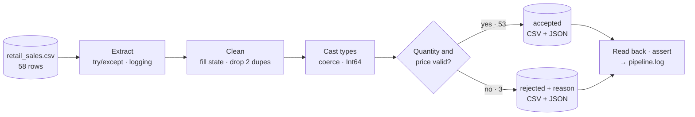

<div align="center">


<br />


**[Problem](#-the-problem) · [Pipeline](#-the-pipeline) · [Quality rules](#-data-quality-rules) · [Results](#-results) · [Run it](#-run-it-yourself) · [What I learned](#-what-i-learned) · [Next steps](#-known-limits-and-next-steps)**

</div>

---

## 🧩 The problem

A retail sales export arrives with copies of the same order, missing quantities and a price typed as text (`"not available"`). Loaded as it is, the totals are wrong or the job crashes. Filling the gaps with `0` would hide the problem and understate revenue.

**Goal:** produce a calculation-ready dataset, keep the rows that can't be trusted to one side **with a reason**, and show that no row was lost or counted twice.

> [!NOTE]
> This is a **learning build** on a deliberately small, synthetic dataset (58 rows, 12 columns, Jan–Jul 2026). The focus is the engineering habits: explicit rules, quarantine instead of delete, and counts that reconcile. It runs locally in a notebook; it is not a scheduled, cloud or production pipeline.

## 🔧 The pipeline



| # | Step | How (pandas / Python) | Why it matters |
|:-:|:--|:--|:--|
| 1 | **Extract and log** | `pd.read_csv` inside `try / except FileNotFoundError`; `logging.basicConfig` | A missing file is logged and stops the run loudly instead of failing silently |
| 2 | **Profile** | `.shape`, `.isnull().sum()`, `.duplicated().sum()`, `.dtypes` | Find the problems before choosing the rules |
| 3 | **Clean** | `df.copy()`, then `fillna({"ShippingState": "Unknown"})` | The original stays untouched; a missing state is labelled, not guessed |
| 4 | **De-duplicate** | `drop_duplicates(keep="first")` | Exact copies would double-count sales |
| 5 | **Cast types** | `to_datetime(errors="coerce")`, `to_numeric(errors="coerce")`, `astype("Int64")` | Bad values become missing instead of crashing the run; nullable integers keep the gaps visible |
| 6 | **Validate and split** | boolean mask `Quantity.isnull() \| UnitPrice.isnull()` | Rows that can't be used in a calculation go to quarantine |
| 7 | **Explain** | `np.select(conditions, reasons)` | Every quarantined row says why it was rejected |
| 8 | **Load** | `to_csv`, `to_json(orient="records", date_format="iso")` | CSV for analysts, JSON for applications |
| 9 | **Verify and log** | read both CSVs back, `assert` the row counts, `logging.info` / `logging.warning` | Evidence that the files match what was processed |

<details>
<summary><b>The core of the split, straight from the notebook</b></summary>

```python
# Step 6: split rejected and accepted orders using the business-required columns
mask = df_copy["Quantity"].isnull() | df_copy["UnitPrice"].isnull()
rejected_orders = df_copy[mask].copy()
accepted = df_copy[~mask].copy()

# Step 6.4: explain why each row is rejected
condition = [
    rejected_orders["Quantity"].isnull(),
    rejected_orders["UnitPrice"].isnull(),
]
reason = ["Missing Quantity", "Invalid Unit Price"]
rejected_orders["Reject Reasons"] = np.select(condition, reason, default="others")

# Basic consistency check before publishing outputs
assert len(accepted) + len(rejected_orders) == len(df_copy), "Some rows were lost or counted twice"
```

</details>

## 🧪 Data quality rules

| Issue found in the raw file | Rows | Rule applied | Why this rule |
|:--|:-:|:--|:--|
| Exact duplicate rows (OrderID `10081`, `10035`) | 2 | Drop; keep the first copy | Prevents double-counting |
| Missing `Quantity` (OrderID `10046`, `10012`) | 2 | **Quarantine** | Never invent how many units were sold |
| `UnitPrice` = `"not available"` (OrderID `10038`) | 1 | Coerce to missing → **quarantine** | A price can't be guessed |
| Missing `DiscountPct` (OrderID `10028`) | 1 | Keep as missing (accepted) | An unknown discount is not 0% |
| Missing `ShippingState` (OrderID `10049`) | 1 | Label `Unknown` (accepted) | Keep the sale without guessing a state |
| `OrderDate` stored as text | 58 | Parse to datetime | Enables time-based analysis |

Full column-by-column rules: [`docs/DATA_DICTIONARY.md`](docs/DATA_DICTIONARY.md).

## 📊 Results


| Measure | Rows |
|:--|--:|
| Raw source | **58** |
| Exact duplicate copies removed | 2 |
| Unique rows | 56 |
| Accepted (typed, exported to CSV and JSON) | **53** |
| Quarantined with a reason | **3** |

**The quarantine file** ([`sample_output/retail_rejected_file.csv`](sample_output/retail_rejected_file.csv)):

| OrderID | Product | Quantity | UnitPrice | Reject Reasons |
|:--|:--|:-:|:-:|:--|
| 10046 | Hand Wash | *missing* | 6.95 | Missing Quantity |
| 10012 | Vitamin C 500mg | *missing* | 16.5 | Missing Quantity |
| 10038 | Face Cleanser | 2 | *missing* (source: `"not available"`) | Invalid Unit Price |

**The run log** ([`sample_output/pipeline.log`](sample_output/pipeline.log)):

```text
INFO:root:Raw CSV loaded successfully
INFO:root:Raw Records: 58
INFO:root:Accepted Records: 53
WARNING:root:Rejected Records: 3
```

The notebook's final cell prints `Complete: 58 raw, 56 unique, 53 accepted, 3 rejected`.

## 🚀 Run it yourself

```bash
git clone https://github.com/Ahmed-Al-Rafsan/retail-sales-etl-pipeline.git
cd retail-sales-etl-pipeline
python -m venv .venv
# Windows PowerShell:  .venv\Scripts\Activate.ps1
# macOS / Linux:       source .venv/bin/activate
python -m pip install -r requirements.txt
```

1. Open `notebooks/retail_sales_ETL_pipeline.ipynb` in VS Code or Jupyter and choose the `.venv` kernel.
2. Make sure the notebook runs from the `notebooks/` folder (it reads `retail_sales.csv` beside it).
3. **Restart → Run All.** Four files and `pipeline.log` are written next to the notebook. Compare them with [`sample_output/`](sample_output/).

## 📁 Repository map

```text
retail-sales-etl-pipeline/
├── notebooks/
│   ├── retail_sales_ETL_pipeline.ipynb   # the pipeline, step by step
│   └── retail_sales.csv                  # copy of the input, so the notebook runs from this folder
├── data/raw/retail_sales.csv             # synthetic source, unmodified
├── sample_output/                        # real outputs from a full run of the notebook
│   ├── retail_accepted_file.csv · .json  # 53 accepted rows
│   ├── retail_rejected_file.csv · .json  # 3 rejected rows + reason
│   └── pipeline.log
├── docs/
│   ├── DATA_DICTIONARY.md                # every column: raw type, final type, rule
│   └── AI_ASSISTANCE.md                  # what I wrote and what AI helped with
├── assets/                               # README graphics
└── requirements.txt
```

## 🧠 What I learned

- **ETL is a chain of decisions, not just code.** Each rule (drop, label, keep missing, quarantine) has a business reason, and writing it down matters as much as the line of pandas.
- **`errors="coerce"`** turns text such as `"not available"` into a missing value, so one bad cell can't crash the whole load.
- **Nullable `Int64`** keeps a quantity as a whole number while still allowing a missing value; a plain `int` can't.
- **Boolean masks** split one DataFrame into two complementary sets (`mask` / `~mask`) with nothing lost in between.
- **`np.select`** turns several conditions into a readable reason label for each rejected row.
- **Logging levels:** `INFO` for normal progress, `WARNING` when rows are rejected, `ERROR` when the source file is missing.
- **Verify the load:** reading the exported files back and asserting the counts catches a bad write before anyone uses the data.

## 🤖 How AI was used

| Part | Who |
|:--|:--|
| Pipeline logic, cleaning rules and notebook steps | **Me** — written step by step in VS Code |
| Code review | **AI (ChatGPT)** — suggested wrapping the CSV load in `try / except` with logging, adding row-count assertions and a portable file path; these are applied in this notebook |
| README, docs and publishing to GitHub | **AI-assisted**, checked by me |

Details: [`docs/AI_ASSISTANCE.md`](docs/AI_ASSISTANCE.md).

## 🔭 Known limits and next steps

| Limit today | Planned next step (not done yet) |
|:--|:--|
| One reason per row: `np.select` records the first failed check | Record every failed check for each row |
| Invalid dates become missing but don't cause rejection | Add an explicit date rule |
| Zero or negative quantities and prices aren't checked | Add business-range rules |
| Manual notebook run | Refactor into functions, add unit tests, run on a schedule |
| Local CSV and JSON outputs | Load into a SQL database, then rebuild the pipeline on Azure Data Factory and Databricks |

---

<div align="center">

**Ahmed Al Rafsan** · Data Analyst → Data Engineering

[GitHub](https://github.com/Ahmed-Al-Rafsan) · [Portfolio](https://ahmed-al-rafsan.github.io/) · [LinkedIn](https://www.linkedin.com/in/ahmed-al-rafsan-/)

</div>
