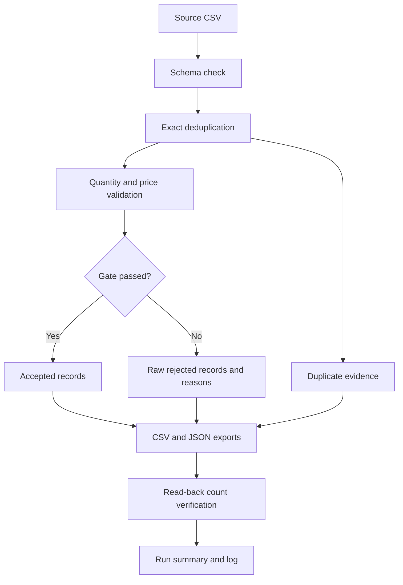

<div align="center">

# Retail Sales ETL Pipeline
### Traceable data quality • Reproducible batch processing • Python

**58 source rows → 2 duplicates → 53 accepted + 3 quarantined**

[Quick start](#quick-start) · [Architecture](#architecture) · [Data contract](docs/DATA_CONTRACT.md) · [Validation evidence](docs/VALIDATION.md) · [Engineering decisions](docs/DECISIONS.md)

</div>

---

## Overview

A local Python pipeline that turns a synthetic retail CSV into validated exports, retains rejected records for investigation, and reconciles every input row. Built as part of **Ahmed Al Rafsan’s progression from Data Analytics into Data Engineering**.

This repository develops a first notebook project into a repeatable command-line workflow. The sample is deliberately small: the engineering focus is explicit rules, reproducibility and evidence. The modular implementation, tests and documentation were developed with AI assistance; the original learning notebook is retained. [Provenance](docs/PROVENANCE.md).

## The problem

Duplicate transactions can inflate reporting. Unknown quantities and invalid prices make reliable calculations impossible. Silently replacing those values with zero hides the problem.

The pipeline removes exact duplicate records, quarantines unusable quantities and prices, and preserves unknown discounts. **Accepted means the quantity/price gate passed**; it does not mean every business attribute is complete or that net revenue can always be calculated.

## Verified outcome

| Measure | Bundled sample |
|:--|--:|
| Input records | 58 |
| Exact duplicates retained separately | 2 |
| Unique records | 56 |
| Accepted records | **53** |
| Rejected records | **3** |
| Accepted records with unknown discount | 1 |
| Automated tests passed locally | **10** |

`58 = 2 duplicate + 53 accepted + 3 rejected`

The [run summary](examples/verified-run/run_summary.json) includes the source SHA-256 and export verification result. These are measured sample results, not throughput or production-scale claims.

## Architecture



## Engineering features

| Capability | Implementation |
|:--|:--|
| Reusable transformation | Pure `transform()` function, separate from file I/O |
| Input contract | Exact expected columns and order; schema mismatch fails early |
| Quality gate | Reject missing, malformed or non-finite numeric values; quantity must be an Int64-compatible whole number |
| Explainable rejection | Preserve source values and record every failed quantity/price check |
| Audit evidence | Duplicate exports, source hash, row reconciliation, run summary |
| Safe reruns | A new output directory per run; existing directories are refused |
| Repeatability | Tested byte-identical exports across two runs on the same source |
| Automated checks | 10 `unittest` tests; GitHub Actions workflow supplied |

## Quick start

Use **Python 3.12**. Download and extract the ZIP, then open the extracted project folder in VS Code. Run all commands from that folder.

```bash
python -m venv .venv
```

Activate on Windows PowerShell:

```powershell
.venv\Scripts\Activate.ps1
```

Or on macOS/Linux:

```bash
source .venv/bin/activate
```

Install and run:

```bash
python -m pip install -r requirements.txt
python -m retail_etl.pipeline --input data/raw/retail_sales.csv --output outputs/run-001
python -m unittest discover -s tests -v
```

For another run, choose `outputs/run-002`. Existing output directories are intentionally protected. If PowerShell blocks activation, invoke `.venv\Scripts\python.exe` directly in place of `python`.

The notebook can also be explored with Jupyter or the VS Code Jupyter extension. Set its working directory to `notebooks/`; a copy of the synthetic CSV is included there. Notebook tooling is optional and is not part of the CLI requirements.

## Outputs

| File | Purpose |
|:--|:--|
| `accepted.csv` / `accepted.json` | Typed records passing the gate |
| `rejected.csv` / `rejected.json` | Source values plus all applicable rejection reasons |
| `duplicates.csv` / `duplicates.json` | Extra exact copies removed from processing |
| `run_summary.json` | Counts, source hash, quality indicators and successful completion marker |
| `pipeline.log` | Completion or export failure details |

A failed write may leave a partial directory. Consumers should require `run_summary.json` before using outputs. Choose a fresh directory when retrying. Failures before export appear on the console.

## Navigate the repository

| Path | Contents |
|:--|:--|
| `retail_etl/pipeline.py` | Transformation, exports and command-line entry point |
| `tests/test_pipeline.py` | Regression, edge-case and integration checks |
| `data/raw/` | Unmodified synthetic source |
| `notebooks/` | Supplied learning notebook with outputs cleared and local input |
| `examples/verified-run/` | Actual outputs generated during local validation |
| `docs/` | Contract, decisions, validation, provenance and GitHub metadata |
| `.github/workflows/ci.yml` | Tests and sample execution on pushes and pull requests |

## Scope and next steps

**Implemented:** local batch processing, CSV/JSON exports, numeric quality checks, duplicate retention, rejection reasons, logging, tests and a CI workflow definition.

**Not implemented:** scheduling, incremental ingestion, database loading, cloud deployment, distributed processing or production monitoring. Dates are parsed and missing dates counted, but invalid dates do not cause rejection. Negative quantities/prices, order-key uniqueness and discount ranges need explicit business policies before adding checks. Money uses floating-point values; this is not a financial ledger.

Possible next milestones are a date/discount contract, a SQL destination and scheduled execution. These are a roadmap, not completed experience.

## Author

**Ahmed Al Rafsan** — Data Analytics → Data Engineering

[GitHub](https://github.com/Ahmed-Al-Rafsan) · [Portfolio](https://ahmed-al-rafsan.github.io/) · [LinkedIn](https://www.linkedin.com/in/ahmed-al-rafsan-/)
